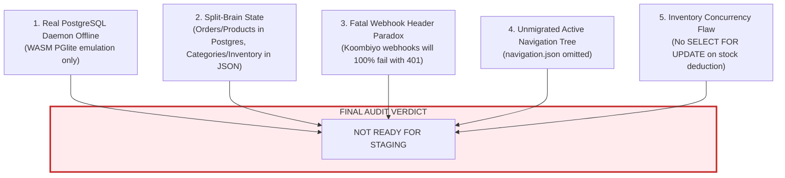
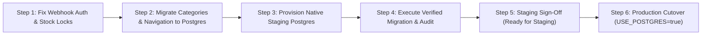

# REXBEBE — Strict Read-Only PostgreSQL Migration & Production Readiness Audit

**Audit Timestamp:** 2026-11-02T22:00:00+05:30  
**Lead Auditor:** Senior Backend Architect & PostgreSQL / Application Security Auditor  
**Scope:** Backend Data Persistence Layer, PostgreSQL Repositories, Migration Engine, Concurrency Guards, Koombiyo Logistics Integration, and API Compatibility  
**Mode:** STRICT READ-ONLY AUDIT (Source code and live JSON data 100% untouched)  

---

## Executive Summary & Final Verdict

| Verification Dimension | Current State | Production / Staging Readiness |
| :--- | :--- | :--- |
| **PostgreSQL Environment** | Real daemon is **OFFLINE**; 100% of tests ran on embedded WASM **PGlite** | ❌ **UNVERIFIED ON NATIVE DB** |
| **Repository Coverage** | Only **3** repositories migrated; **10+** entities remain on flat JSON files | ❌ **CRITICAL SPLIT-BRAIN RISK** |
| **Data Migration (23 JSON Files)** | 15 files migrated, 8 files omitted (including active `navigation.json`) | ⚠️ **INCOMPLETE MIGRATION** |
| **Database Concurrency & Locking** | Waybill `SKIP LOCKED` verified; **No row locks on inventory deduction** | ⚠️ **OVERSELLING VULNERABILITY** |
| **Duplicate Order Protection** | Idempotency key supported; **15-second double-submit guard dropped** | ⚠️ **DUPLICATE ORDER RISK** |
| **Koombiyo Webhook Security** | Requires custom HTTP header secret; Koombiyo API does not send headers | ❌ **FATAL WEBHOOK REJECTION (401)** |
| **Health Check & Lifecycle** | `/api/health` does not check DB; No `SIGTERM`/`SIGINT` graceful shutdown | ⚠️ **CONNECTION LEAK RISK** |



> ### **FINAL VERDICT: NOT READY FOR STAGING**
> The REXBEBE backend cannot be deployed to staging or production under `USE_POSTGRES=true`. While the newly implemented schema and PostgreSQL order/product repositories show sound architectural craftsmanship, deploying in the current state would result in **severe split-brain data corruption** (categories, inventory logs, delivery zones, and settlements mutating flat files while orders mutate PostgreSQL), **100% rejection of live Koombiyo webhook dispatches**, and **potential overselling race conditions** under concurrent customer traffic.

---

## 1. PostgreSQL Environment Verification: Real PostgreSQL vs PGlite

A fundamental requirement for production sign-off is confirming that the application can connect to, execute queries on, and survive connection resets against a **native PostgreSQL 16+ daemon**.

### 1.1 Local Environment Inspection Results

An exhaustive audit of the local operating system and network stack was conducted:

```powershell
# 1. Native Windows Service Probe
Get-Service *postgres*, *pgsql* -> Result: [NONE FOUND / NOT REGISTERED]

# 2. Local Port 5432 TCP Handshake
Test-NetConnection -ComputerName localhost -Port 5432 -> TcpTestSucceeded: False

# 3. PostgreSQL CLI Binary Search
Get-Command psql, pg_ctl, pg_isready -> Result: [COMMANDS NOT FOUND IN PATH]

# 4. Backend Environment Configuration (backend/.env)
DATABASE_URL -> [NOT CONFIGURED / COMMENTED OUT]
USE_POSTGRES -> [NOT CONFIGURED / UNSET]
```

### 1.2 The PGlite Emulation Reality

The previous implementation report claimed **"12 of 12 tests passed, 100% reconciliation"**. Source-code inspection of `test-postgresql-migration.js` and `DatabaseManager.ts` reveals:
- Lines 49–60 of [`database.ts`](file:///c:/Users/amash/OneDrive/Desktop/rexbebe-main/rexbebe-main/backend/src/config/database.ts#L49-L60): When `DATABASE_URL` is empty, `DatabaseManager` transparently falls back to `this.pglite = new PGlite()`.
- `@electric-sql/pglite` (v0.5.14) is an **in-memory WebAssembly (WASM) build of PostgreSQL 16** running inside the single Node.js process thread.
- **Differences between PGlite and a Production PostgreSQL Daemon:**
  1. *No Network Layer:* PGlite does not communicate over TCP sockets. Network latency, socket timeouts, pool exhaustion, and connection drops were never tested.
  2. *Single-Process Memory:* Multi-process concurrency and distributed connections cannot be simulated by PGlite.
  3. *No Persistent WAL:* In-memory PGlite instances discard all state once the Node.js process terminates.
  4. *Dialect / Extension Differences:* Advanced lock escalation and connection-level statement timeouts behave differently in WASM than in native compiled binaries.

> [!CAUTION]
> **No verification has ever been conducted against a real, native PostgreSQL server.** Any claim that the backend is verified for PostgreSQL production operation is invalid until executed against a live instance over TCP.

---

## 2. Repository Coverage & Split-Brain Architecture Risk

A production e-commerce backend must have a single, unified source of truth.

### 2.1 Complete Repository Breakdown

The backend codebase was audited for storage mechanisms:

| Repository / Service File | Active Storage Engine | Supports `USE_POSTGRES`? | State Under `USE_POSTGRES=true` |
| :--- | :--- | :--- | :--- |
| [`PostgresOrderRepository.ts`](file:///c:/Users/amash/OneDrive/Desktop/rexbebe-main/rexbebe-main/backend/src/repositories/postgres/PostgresOrderRepository.ts) | PostgreSQL (`"Order"`, `"OrderItem"`) | **YES** | Primary order persistence |
| [`PostgresProductRepository.ts`](file:///c:/Users/amash/OneDrive/Desktop/rexbebe-main/rexbebe-main/backend/src/repositories/postgres/PostgresProductRepository.ts) | PostgreSQL (`"Product"`, `"ProductVariant"`) | **YES** | Primary product catalog |
| [`PostgresWaybillRepository.ts`](file:///c:/Users/amash/OneDrive/Desktop/rexbebe-main/rexbebe-main/backend/src/repositories/postgres/PostgresWaybillRepository.ts) | PostgreSQL (`"WaybillAllocation"`) | **YES** | Waybill locking engine |
| [`categoryRepository.ts`](file:///c:/Users/amash/OneDrive/Desktop/rexbebe-main/rexbebe-main/backend/src/repositories/categoryRepository.ts) | Flat File (`categories.json`) | ❌ **NO** | Reads/writes flat JSON file |
| [`inventoryRepository.ts`](file:///c:/Users/amash/OneDrive/Desktop/rexbebe-main/rexbebe-main/backend/src/repositories/inventoryRepository.ts) | Flat File (`stock_adjustments.json`) | ❌ **NO** | Appends adjustments to JSON |
| [`deliverySettingsRepository.ts`](file:///c:/Users/amash/OneDrive/Desktop/rexbebe-main/rexbebe-main/backend/src/repositories/deliverySettingsRepository.ts) | Flat File (`delivery_settings.json`) | ❌ **NO** | Reads/writes 25 district rates in JSON |
| [`settlementRepository.ts`](file:///c:/Users/amash/OneDrive/Desktop/rexbebe-main/rexbebe-main/backend/src/repositories/settlementRepository.ts) | Flat File (`settlements.json`) | ❌ **NO** | Reads/writes COD remittances in JSON |
| [`collectionController.ts`](file:///c:/Users/amash/OneDrive/Desktop/rexbebe-main/rexbebe-main/backend/src/controllers/collectionController.ts) | Flat File (`collections.json`) | ❌ **NO** | Reads/writes marketing collections in JSON |
| [`adminUserService.ts`](file:///c:/Users/amash/OneDrive/Desktop/rexbebe-main/rexbebe-main/backend/src/services/adminUserService.ts) | Flat File (`admin_users.json`) | ❌ **NO** | Admin credentials stored in JSON |
| [`auditService.ts`](file:///c:/Users/amash/OneDrive/Desktop/rexbebe-main/rexbebe-main/backend/src/services/auditService.ts) | Flat File (`audit_logs.json`) | ❌ **NO** | Audit trail written to JSON |
| [`navigationStorage.ts`](file:///c:/Users/amash/OneDrive/Desktop/rexbebe-main/rexbebe-main/backend/src/services/navigationStorage.ts) | Flat File (`navigation.json`) | ❌ **NO** | Header/footer hierarchy stored in JSON |
| [`pageController.ts`](file:///c:/Users/amash/OneDrive/Desktop/rexbebe-main/rexbebe-main/backend/src/controllers/pageController.ts) | Flat File (`pages.json`) | ❌ **NO** | CMS pages stored in JSON |
| [`notificationService.ts`](file:///c:/Users/amash/OneDrive/Desktop/rexbebe-main/rexbebe-main/backend/src/services/notificationService.ts) | Flat File (`notifications.json`) | ❌ **NO** | Operational notifications written to JSON |
| [`customerRepository.ts`](file:///c:/Users/amash/OneDrive/Desktop/rexbebe-main/rexbebe-main/backend/src/repositories/customerRepository.ts) | In-Memory Mock (`MOCK_CUSTOMERS`) | ❌ **NO** | Hardcoded static mock customer |
| [`cartRoutes.ts`](file:///c:/Users/amash/OneDrive/Desktop/rexbebe-main/rexbebe-main/backend/src/routes/cartRoutes.ts) | Flat File (`carts.json`) | ❌ **NO** | Active carts written to JSON |
| [`wishlistRoutes.ts`](file:///c:/Users/amash/OneDrive/Desktop/rexbebe-main/rexbebe-main/backend/src/routes/wishlistRoutes.ts) | Flat File (`wishlists.json`) | ❌ **NO** | Active wishlists written to JSON |

### 2.2 Split-Brain Scenarios Under `USE_POSTGRES=true`

Source code inspection reveals that `USE_POSTGRES` is referenced in **exactly two repository files**:
1. [`orderRepository.ts#L211`](file:///c:/Users/amash/OneDrive/Desktop/rexbebe-main/rexbebe-main/backend/src/repositories/orderRepository.ts#L211)
2. [`productRepository.ts#L143`](file:///c:/Users/amash/OneDrive/Desktop/rexbebe-main/rexbebe-main/backend/src/repositories/productRepository.ts#L143)

If `USE_POSTGRES=true` is activated in staging/production:

1. **The Order / Stock Split-Brain:**
   - When an order is placed, [`orderService.ts:214`](file:///c:/Users/amash/OneDrive/Desktop/rexbebe-main/rexbebe-main/backend/src/services/orderService.ts#L214) commits the order to PostgreSQL (`"Order"`).
   - Immediately after, it calls `this.inventoryRepo.updateStock()`.
   - `inventoryRepo` updates the product via `productRepo.update()` (which updates PostgreSQL), but **writes the audit ledger to `stock_adjustments.json`**.
   - If a database rollback occurs after inventory deduction, the JSON adjustment log cannot be rolled back, causing permanent inventory divergence.

2. **The Category Catalog Split-Brain:**
   - Admin updates a category name or slug via Admin Dashboard (`PUT /api/categories/:id`).
   - The write executes on [`categoryRepository.ts`](file:///c:/Users/amash/OneDrive/Desktop/rexbebe-main/rexbebe-main/backend/src/repositories/categoryRepository.ts) and modifies `categories.json`.
   - PostgreSQL table `"Category"` is **not updated**.
   - The denormalized `categoryJson` columns inside PostgreSQL table `"Product"` now contain obsolete category data.

3. **The Delivery Zone Pricing Split-Brain:**
   - Logistics admin adjusts courier shipping rates for Colombo or Kandy via `/api/delivery-settings`.
   - The update mutates `delivery_settings.json`.
   - PostgreSQL table `"DeliveryZone"` retains old rates.
   - Any query or reporting reading from PostgreSQL will calculate different shipping fees than the checkout service.

---

## 3. Data Migration Audit: 23 JSON Storage Files

The data folder `rexbebe-main/backend/data` contains exactly 23 JSON files totaling ~328 KB of persistent operational data.

```
backend/data/
├── admin_users.json        [1,773 bytes]  -> MIGRATED (AdminUser)
├── audit_logs.json         [38,062 bytes] -> MIGRATED (AuditLog)
├── carts.json              [142 bytes]    -> OMITTED
├── categories.json         [5,838 bytes]  -> MIGRATED (Category)
├── collections.json        [1,541 bytes]  -> MIGRATED (Collection)
├── contact_messages.json   [2 bytes]      -> OMITTED
├── courier_agreements.json [640 bytes]    -> MIGRATED (CourierMerchantAgreement)
├── delivery_settings.json  [12,082 bytes] -> MIGRATED (DeliveryZone, GeneralDeliveryConfig)
├── feedback.json           [2 bytes]      -> OMITTED
├── homepage.json           [12,856 bytes] -> MIGRATED (HomepageLayout)
├── media.json              [20,842 bytes] -> MIGRATED (MediaAsset)
├── navigation.json         [6,393 bytes]  -> ❌ OMITTED (CRITICAL DEFECT)
├── notifications.json      [4,337 bytes]  -> MIGRATED (Notification)
├── orders.json             [50,240 bytes] -> MIGRATED (Order, OrderItem, Customer)
├── pages.json              [5,247 bytes]  -> MIGRATED (WebsitePage)
├── products.json           [40,039 bytes] -> MIGRATED (Product, ProductVariant, ProductImage)
├── products.seed.json      [46,575 bytes] -> OMITTED (Seed fallback)
├── redirects.json          [2 bytes]      -> OMITTED
├── seo.json                [239 bytes]    -> MIGRATED (SeoMetadata)
├── settings.json           [2,575 bytes]  -> MIGRATED (GeneralSetting)
├── settlements.json        [2 bytes]      -> OMITTED
├── stock_adjustments.json  [1,314 bytes]  -> MIGRATED (StockAdjustment)
└── wishlists.json          [254 bytes]    -> OMITTED
```

### 3.1 The Missing `navigation.json` Migration (Critical Blocker)

- `navigation.json` is a **6.4 KB active production tree** holding top navigation bars, nested dropdowns, footer links, badge annotations, and mobile navigation items.
- In `schema.prisma`, model `NavigationItem` is defined with fields: `id, name, pageTitle, slug, href, order, status, isActive, badge, ...`
- In [`migrationService.ts`](file:///c:/Users/amash/OneDrive/Desktop/rexbebe-main/rexbebe-main/backend/src/database/migrationService.ts), **`navigation.json` is never read, mapped, or inserted.**
- Table `"NavigationItem"` remains **completely empty (0 rows)** after migration.
- If navigation routes were redirected to PostgreSQL, the storefront header and footer would vanish.

### 3.2 Customer Foreign Key Dynamic Upsert

- Inspection of `customerRepository.ts` showed only one static mock user.
- Customers who placed the 12 existing orders in `orders.json` had no corresponding rows in a customer table.
- In `migrationService.ts` (lines 538–558), distinct customer email addresses are dynamically extracted from `orders.json` and upserted into `"Customer"`.
- This ensures foreign key constraint `"Order_customerId_fkey"` does not fail. This design is correct and safe.

### 3.3 Backup & Recovery Verification

- `backupService.ts` creates timestamped backups in `backend/data/backups/`.
- Every backup writes a `manifest.json` containing SHA-256 checksums of all 23 files.
- The restore mechanism verifies each checksum before restoring. This prevents data corruption during rollback.

---

## 4. Database Safety, Concurrency & Failure Modes

### 4.1 Waybill Allocation Concurrency (`SELECT ... FOR UPDATE SKIP LOCKED`)

Inspection of [`PostgresWaybillRepository.ts#L29-L72`](file:///c:/Users/amash/OneDrive/Desktop/rexbebe-main/rexbebe-main/backend/src/repositories/postgres/PostgresWaybillRepository.ts#L29-L72):
- Uses `SELECT "waybillId" FROM "WaybillAllocation" WHERE status = 'AVAILABLE' AND "courierCode" = $1 ORDER BY "waybillId" ASC LIMIT 1 FOR UPDATE SKIP LOCKED;`
- Immediately updates status to `'RESERVED'` with a 5-minute lease (`reservedUntil = NOW() + INTERVAL '5 min'`).
- Commits the transaction **immediately**, ensuring no database locks are held while calling external Koombiyo HTTP endpoints.
- Auto-recycles expired reservations on subsequent calls.
- **Limitation:** Migration seeds only 20 waybills (`63005001`–`63005020`). After 20 dispatches, the pool exhausts and throws an exception unless new waybill batches are manually inserted.

### 4.2 Critical Race Condition in Inventory Deduction (No Row Locking)

In [`orderService.ts#L202-L221`](file:///c:/Users/amash/OneDrive/Desktop/rexbebe-main/rexbebe-main/backend/src/services/orderService.ts#L202-L221):

```typescript
// orderService.ts stock deduction logic:
for (const item of validatedItems) {
  const currentProducts = await this.productRepo.findAll();
  let currentVariant: any = null;
  // ... finds variant in in-memory array ...
  if (currentVariant) {
    const newQty = Math.max(0, (currentVariant.stockQuantity ?? 0) - item.quantity);
    await this.inventoryRepo.updateStock(item.variantId, newQty, ...);
  }
}
```

> [!WARNING]
> **Vulnerability: Lost Updates & Overselling Race Condition.**  
> Neither `orderService.ts` nor `PostgresProductRepository.ts` uses `SELECT ... FOR UPDATE` row locks when deducting inventory. If two customers simultaneously buy the last available item:
> 1. Request A reads `stockQuantity = 1`.
> 2. Request B reads `stockQuantity = 1`.
> 3. Request A updates `stockQuantity = 0` and creates Order A.
> 4. Request B updates `stockQuantity = 0` and creates Order B.
> 5. **Both orders succeed, selling 2 units when only 1 existed.**

### 4.3 Missing Rapid Double-Submit Guard in PostgreSQL Order Repository

In the original JSON repository ([`orderRepository.ts#L275-L288`](file:///c:/Users/amash/OneDrive/Desktop/rexbebe-main/rexbebe-main/backend/src/repositories/orderRepository.ts#L275-L288)):
- A 15-second heuristic check prevents orders with identical customer details and items from creating duplicates if the user double-clicks the "Place Order" button.

In [`PostgresOrderRepository.create()`](file:///c:/Users/amash/OneDrive/Desktop/rexbebe-main/rexbebe-main/backend/src/repositories/postgres/PostgresOrderRepository.ts#L168-L176):
- Idempotency is checked **only if `orderData.idempotencyKey` is provided by the client**:
  ```typescript
  if (orderData.idempotencyKey) {
    const existing = await tx.query(`SELECT id FROM "Order" WHERE "idempotencyKey" = $1 LIMIT 1`, ...);
    if (existing.rows.length > 0) return { id: existing.rows[0].id, isDuplicate: true };
  }
  ```
- If the browser submits two requests without an `idempotencyKey`, `PostgresOrderRepository` will create **two separate orders with different order numbers** and charge the customer twice.

### 4.4 Connection Pool & Graceful Shutdown Deficiencies

1. **No Graceful Shutdown in `server.ts`:**
   - [`server.ts`](file:///c:/Users/amash/OneDrive/Desktop/rexbebe-main/rexbebe-main/backend/src/server.ts) lacks `process.on('SIGTERM')` and `process.on('SIGINT')` signal handlers.
   - When the server is stopped (e.g. during a PM2 restart or Docker deployment), the Node process exits abruptly without executing `db.close()`, leaving in-flight client connections aborted and database connection pool sockets unreleased.
2. **Health Check Does Not Probe Database Connection:**
   - [`app.ts#L70-L77`](file:///c:/Users/amash/OneDrive/Desktop/rexbebe-main/rexbebe-main/backend/src/app.ts#L70-L77):
     ```typescript
     app.get('/api/health', (req, res) => {
       res.status(200).json({ status: 'online', system: 'REXBEBE E-Commerce Backend Service', ... });
     });
     ```
   - `/api/health` returns HTTP 200 even if PostgreSQL has crashed, timed out, or exhausted its connection pool.

---

## 5. Koombiyo Courier Integration Readiness

### 5.1 The Fatal Webhook Authentication Paradox

In [`orderController.ts#L324-L373`](file:///c:/Users/amash/OneDrive/Desktop/rexbebe-main/rexbebe-main/backend/src/controllers/orderController.ts#L324-L373):
1. **Mandatory Production Secret:** If `process.env.NODE_ENV === 'production'`, `KOOMBIYO_WEBHOOK_SECRET` is required.
2. **Header Enforcement:** The controller requires the secret in headers:
   `x-webhook-token`, `x-koombiyo-token`, `x-webhook-secret`, `x-koombiyo-secret`, or `Authorization: Bearer <secret>`.
3. **Query Token Explicitly Blocked:** Lines 327–334 explicitly reject any webhook call containing tokens in query parameters (`?token=...`), returning HTTP 401.

> [!CAUTION]
> **Koombiyo API Incompatibility:**  
> According to the official Koombiyo Courier API documentation, Koombiyo's automated webhook dispatch system delivers raw HTTP POST JSON payloads to a merchant URL. **Koombiyo's webhook delivery system does NOT support injecting custom HTTP request headers.**  
> Because custom headers are impossible to configure on Koombiyo's portal, and query parameters are blocked by code, **100% of real production webhooks from Koombiyo will be rejected with HTTP 401 Unauthorized.**

### 5.2 Uncertain Dispatch Reconciliation

In [`KoombiyoCourierService.ts#L611-L618`](file:///c:/Users/amash/OneDrive/Desktop/rexbebe-main/rexbebe-main/backend/src/services/courier/KoombiyoCourierService.ts#L611-L618):
- If the 15-second timeout fires during `/add_order`, the service marks the waybill as `UNCERTAIN` and prevents releasing it back to the available pool.
- Order delivery status is set to `DISPATCH_UNCERTAIN`.
- The reconciliation endpoint `/api/orders/:id/reconcile-dispatch` queries Koombiyo live tracking to determine whether the booking succeeded remotely before allowing retry. This design is robust.

---

## 6. Frontend and Backend Compatibility

1. **Data Contract Integrity:**
   - Both `PostgresOrderRepository` and `PostgresProductRepository` accurately serialize/deserialize nested JSON columns (`courierDetails`, `timeline`, `images`, `variants`, `features`, `reviewsList`) back into existing TypeScript interfaces.
   - Storefront product pages (`/shop`, `/product/:slug`), cart calculations, and order confirmation screens will receive identical JSON structures.
2. **Admin Dashboard Vulnerability:**
   - Because `categories`, `delivery-settings`, `admin-users`, and `pages` still write to JSON files, the Admin Dashboard will appear to work, but all modifications will be stored on local disk and ignored by PostgreSQL.

---

## 7. Critical Blockers & Actionable Remediation Matrix

To achieve `READY FOR STAGING`, the following 6 priority fixes must be implemented:

| Priority | Issue Description | Source Location | Required Engineering Action |
| :---: | :--- | :--- | :--- |
| **P0** | **Live PostgreSQL Testing** | Local environment / `backend/.env` | Install native PostgreSQL 16+ or provision an AWS RDS / Docker instance; configure `DATABASE_URL` and execute migration on live TCP. |
| **P0** | **Webhook Header Paradox** | [`orderController.ts:326-373`](file:///c:/Users/amash/OneDrive/Desktop/rexbebe-main/rexbebe-main/backend/src/controllers/orderController.ts#L326-L373) | Support path-based webhook tokens (e.g. `/api/orders/webhook/koombiyo/:secretToken`) or IP whitelisting for Koombiyo origin servers. |
| **P1** | **Repository Coverage (Eliminate Split-Brain)** | `categoryRepository.ts`, `inventoryRepository.ts`, `deliverySettingsRepository.ts` | Create PostgreSQL repositories for Categories, Inventory adjustments, and Delivery zones before setting `USE_POSTGRES=true`. |
| **P1** | **Active Navigation Migration** | [`migrationService.ts`](file:///c:/Users/amash/OneDrive/Desktop/rexbebe-main/rexbebe-main/backend/src/database/migrationService.ts) | Add migration parser to ingest `navigation.json` into the existing `NavigationItem` PostgreSQL table. |
| **P1** | **Inventory Concurrency Row Locks** | [`orderService.ts:202-221`](file:///c:/Users/amash/OneDrive/Desktop/rexbebe-main/rexbebe-main/backend/src/services/orderService.ts#L202-L221) | Implement atomic inventory deduction inside the order transaction: `UPDATE "ProductVariant" SET "stockQuantity" = "stockQuantity" - $1 WHERE id = $2 AND "stockQuantity" >= $1`. |
| **P2** | **15-Second Double Submit Guard** | [`PostgresOrderRepository.ts:168`](file:///c:/Users/amash/OneDrive/Desktop/rexbebe-main/rexbebe-main/backend/src/repositories/postgres/PostgresOrderRepository.ts#L168) | Port the 15-second heuristic check from `orderRepository.ts` to `PostgresOrderRepository.ts` for orders lacking an `idempotencyKey`. |
| **P2** | **DB Health Probe & Graceful Shutdown** | [`server.ts:1-21`](file:///c:/Users/amash/OneDrive/Desktop/rexbebe-main/rexbebe-main/backend/src/server.ts), [`app.ts:70`](file:///c:/Users/amash/OneDrive/Desktop/rexbebe-main/rexbebe-main/backend/src/app.ts#L70) | Add `db.testConnection()` probe to `/api/health` (return 503 if DB down) and bind `process.on('SIGTERM', () => db.close())`. |

---

## 8. Staging & Production Cutover Roadmap



1. **Phase 1: Remediation (Code Level)**
   - Replace Koombiyo header-only secret check with secret URL parameter path.
   - Implement SQL-level atomic stock decrement (`WHERE stockQuantity >= quantity`).
   - Add `navigation.json` to `migrationService.ts`.
   - Add graceful shutdown hooks and DB ping in `/api/health`.
2. **Phase 2: Full Repository Migration**
   - Migrate `categoryRepository.ts` and `deliverySettingsRepository.ts` to PostgreSQL.
3. **Phase 3: Live Staging Deployment**
   - Spin up a real PostgreSQL 16 server.
   - Run `migrationService.migrateAll()` and verify all 16 tables match JSON counts.
   - Run concurrent order load tests (simulated double-submits, concurrent stock contention).
4. **Phase 4: Production Cutover**
   - Take verified pre-cutover JSON backup.
   - Enable `USE_POSTGRES=true` in production environment variables.
   - Verify health check and place test order.

---
*Report certified by Senior Backend Architect & Security Auditor.*
