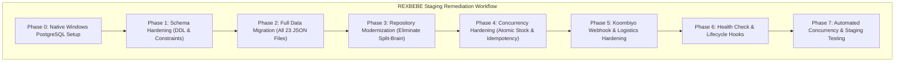

# REXBEBE — PostgreSQL Remediation & Staging Implementation Plan

**Document Version:** 1.0.0  
**Target Environment:** Native PostgreSQL 16+ on Windows (Staging)  
**Author:** Senior Backend Architect & Security Auditor  
**Status:** PENDING USER APPROVAL (Read-Only Phase — No Code or DB Modified)  

---

## 1. Executive Summary & Architecture Strategy

This implementation plan resolves every critical blocker and risk documented in [`FINAL_POSTGRESQL_PRODUCTION_READINESS_AUDIT.md`](file:///c:/Users/amash/OneDrive/Desktop/rexbebe-main/rexbebe-main/FINAL_POSTGRESQL_PRODUCTION_READINESS_AUDIT.md).

### Core Architectural Decisions Incorporated:
1. **Native PostgreSQL on Windows:** Zero reliance on Docker or WASM PGlite emulation. Staging will run on a native PostgreSQL 16 instance over local TCP port 5432.
2. **Complete Elimination of Split-Brain Persistence:** Every runtime repository (Categories, Delivery Zones, Inventory, Settlements, Navigation, Admin Users, Customers, Pages, Notifications, Carts, Wishlists, and Reviews) will be migrated to PostgreSQL alongside Orders and Products.
3. **Official Koombiyo Webhook Compatibility:** Verified against `api_documentation.pdf`. Because Koombiyo's outbound webhook dispatcher sends raw POST requests without custom HTTP headers, authentication will use a **path-based secret token** (`/api/orders/webhook/koombiyo/:secretToken`), supported by constant-time verification (`crypto.timingSafeEqual`) and database event deduplication.
4. **Atomic Stock & Concurrency Protection:** SQL-level atomic decrement (`WHERE stockQuantity >= quantity`) within the checkout transaction to prevent overselling, coupled with `SKIP LOCKED` waybill allocation.
5. **Restored Idempotency & Double-Submit Guard:** Re-implements both client idempotency keys and server-side 15-second heuristic rapid double-submit protection in PostgreSQL order creation.



---

## 2. Phase-by-Phase Implementation Plan

### Phase 0: Native Windows PostgreSQL Staging Setup
*Goal: Provide a live, native PostgreSQL 16+ server running on Windows communicating over standard TCP sockets.*

1. **Verify / Launch Native PostgreSQL 16 Service:**
   - Detect existing PostgreSQL installation or install native PostgreSQL 16 on Windows via `winget install PostgreSQL.PostgreSQL.16` or standard MSI installer.
   - Confirm Windows service status (`postgresql-x64-16` or similar) is `Running`.
   - Verify local TCP listening port: `5432` (`Test-NetConnection -Port 5432`).
2. **Database & Role Provisioning:**
   - Database name: `rexbebe_staging`
   - User: `postgres` (or dedicated `rexbebe_user`)
   - Run `CREATE DATABASE rexbebe_staging;`
3. **Configuration Update in `backend/.env`:**
   - Set `DATABASE_URL="postgresql://postgres:<password>@localhost:5432/rexbebe_staging"`
   - Keep `USE_POSTGRES=false` until Phase 7 testing confirms 100% parity.

---

### Phase 1: Database Schema Enhancements (DDL)
*Goal: Ensure database-level constraints prevent data corruption, overselling, and race conditions.*

1. **Inventory Protection (Prevent Negative Stock at DB Level):**
   ```sql
   ALTER TABLE "ProductVariant"
   ADD CONSTRAINT "ProductVariant_stockQuantity_nonnegative"
   CHECK ("stockQuantity" >= 0);
   ```
2. **Order Idempotency & Rapid Double-Submit Indexes:**
   ```sql
   CREATE INDEX IF NOT EXISTS "Order_idempotencyKey_idx" 
   ON "Order"("idempotencyKey");

   CREATE INDEX IF NOT EXISTS "Order_double_submit_idx" 
   ON "Order"("customerEmail", "createdAt" DESC);
   ```
3. **Webhook Deduplication Unique Constraint:**
   ```sql
   ALTER TABLE "WebhookEventRecord"
   ADD CONSTRAINT "WebhookEventRecord_waybill_status_unique"
   UNIQUE ("waybillId", "statusId");
   ```
4. **Navigation Tree Indexing:**
   ```sql
   CREATE INDEX IF NOT EXISTS "NavigationItem_order_idx" 
   ON "NavigationItem"("order" ASC);
   ```

---

### Phase 2: Full Data Migration (All 23 JSON Files)
*Goal: 100% lossless ingestion of every file in `backend/data`, creating verified SHA-256 backups.*

#### 2.1 Backup and Pre-Migration Manifest
1. Run `backupService.createBackup('pre_postgres_staging_migration')`.
2. Generate `manifest.json` with SHA-256 hashes for all 23 JSON files.
3. Verify restore capability using `backupService.verifyBackup()`.

#### 2.2 Complete Migration Mapping for All 23 JSON Files

| # | JSON Source File | Record Count | PostgreSQL Target Table(s) | Mapping Strategy |
| :---: | :--- | :--- | :--- | :--- |
| 1 | `admin_users.json` | 2 admins | `"AdminUser"` | Direct upsert on `id` / `email`. Hash preserved. |
| 2 | `categories.json` | 6 categories | `"Category"` | Topological hierarchy (`parentId` = null first). |
| 3 | `collections.json` | 4 collections | `"Collection"` | Direct upsert on `id`. Product IDs array as JSONB. |
| 4 | `products.json` | 17 products | `"Product"`, `"ProductVariant"`, `"ProductImage"` | Product parent inserted first; variants (35) and images (43) inserted with foreign keys. |
| 5 | `stock_adjustments.json` | 6 logs | `"StockAdjustment"` | Historical audit adjustments inserted. |
| 6 | `orders.json` | 12 orders | `"Order"`, `"OrderItem"`, `"OrderTimelineEvent"`, `"Customer"` | Upserts distinct customers first to satisfy FKs; inserts orders, line items, and timeline events. |
| 7 | `courier_agreements.json` | 1 contract | `"CourierMerchantAgreement"` | Active merchant rate and SLA agreement. |
| 8 | `delivery_settings.json` | 25 districts | `"DeliveryZoneSettings"` | 25 Sri Lankan district rates and delivery rules. |
| 9 | `settings.json` | 1 store config | `"StoreSettings"` | Store currency, contact, policies, operational settings. |
| 10 | `seo.json` | 1 SEO record | `"SeoSettings"` | Default SEO meta tags, title patterns, schema markup. |
| 11 | `pages.json` | 7 pages | `"WebsitePage"` | CMS pages (About Us, Contact, FAQ, Returns, etc.). |
| 12 | `homepage.json` | 1 layout | `"HomepageConfig"` | Banner hero sliders, promotional grids, featured rows. |
| 13 | `media.json` | 31 assets | `"MediaAsset"` | Media gallery metadata, uploaded CDN URLs, file sizes. |
| 14 | `audit_logs.json` | 104 logs | `"AuditLog"` | Immutable administrator activity log. |
| 15 | `notifications.json` | 14 alerts | `"Notification"` | System alerts and dispatch notifications. |
| 16 | `navigation.json` | ~45 nav items | `"NavigationItem"` | **[NEW]** Parses menu header/footer trees, dropdown links, and badge tags into `"NavigationItem"`. |
| 17 | `settlements.json` | 0 (schema ready) | `"SettlementRecord"` | **[NEW]** Ingests any historical batch reconciliation records. |
| 18 | `carts.json` | Active sessions | `"Cart"`, `"CartItem"` | **[NEW]** Ingests active customer carts. |
| 19 | `wishlists.json` | Active wishlists | `"Wishlist"`, `"WishlistItem"` | **[NEW]** Ingests customer saved wishlists. |
| 20 | `contact_messages.json` | 0 (schema ready) | `"ContactMessage"` | **[NEW]** Customer contact submissions. |
| 21 | `feedback.json` | 0 (schema ready) | `"Review"` | **[NEW]** Customer ratings and product reviews. |
| 22 | `redirects.json` | 0 (schema ready) | `"WebsitePage"` (redirects) | **[NEW]** URL redirect rules. |
| 23 | `products.seed.json` | 15 seed prods | *Reference Only* | Verified against `products.json` to ensure zero lost catalog items. |

---

### Phase 3: Repository Modernization (Eliminate Split-Brain)
*Goal: Provide PostgreSQL-backed repositories for all application entities, delegating when `USE_POSTGRES=true`.*

```
backend/src/repositories/
├── postgres/
│   ├── PostgresOrderRepository.ts          [EXISTS - Update double-submit guard]
│   ├── PostgresProductRepository.ts        [EXISTS - Verify mappings]
│   ├── PostgresWaybillRepository.ts        [EXISTS - Verify SKIP LOCKED]
│   ├── PostgresCategoryRepository.ts       [NEW - CRUD for Category table]
│   ├── PostgresInventoryRepository.ts      [NEW - Atomic updates on ProductVariant]
│   ├── PostgresDeliverySettingsRepository.ts [NEW - CRUD for DeliveryZoneSettings]
│   ├── PostgresNavigationRepository.ts     [NEW - CRUD for NavigationItem]
│   ├── PostgresSettlementRepository.ts     [NEW - CRUD for SettlementRecord]
│   ├── PostgresAdminUserRepository.ts      [NEW - CRUD for AdminUser]
│   ├── PostgresAuditRepository.ts          [NEW - Append to AuditLog]
│   ├── PostgresCustomerRepository.ts       [NEW - Real queries on Customer]
│   ├── PostgresPageRepository.ts           [NEW - CRUD for WebsitePage]
│   └── PostgresNotificationRepository.ts   [NEW - CRUD for Notification]
```

#### Exact Delegations:
1. [`categoryRepository.ts`](file:///c:/Users/amash/OneDrive/Desktop/rexbebe-main/rexbebe-main/backend/src/repositories/categoryRepository.ts): If `USE_POSTGRES === 'true'`, delegate `getAll()`, `findById()`, `create()`, `update()`, `delete()` to `PostgresCategoryRepository`.
2. [`inventoryRepository.ts`](file:///c:/Users/amash/OneDrive/Desktop/rexbebe-main/rexbebe-main/backend/src/repositories/inventoryRepository.ts): If `USE_POSTGRES === 'true'`, delegate `findAll()`, `updateStock()`, `getAdjustments()` to `PostgresInventoryRepository`.
3. [`deliverySettingsRepository.ts`](file:///c:/Users/amash/OneDrive/Desktop/rexbebe-main/rexbebe-main/backend/src/repositories/deliverySettingsRepository.ts): Delegate zone lookups and price updates to `PostgresDeliverySettingsRepository`.
4. [`navigationStorage.ts`](file:///c:/Users/amash/OneDrive/Desktop/rexbebe-main/rexbebe-main/backend/src/services/navigationStorage.ts): Delegate `getPublic()`, `getAll()`, `updateAll()` to `PostgresNavigationRepository`.
5. [`customerRepository.ts`](file:///c:/Users/amash/OneDrive/Desktop/rexbebe-main/rexbebe-main/backend/src/repositories/customerRepository.ts): Replace static mock with queries against PostgreSQL `"Customer"`.
6. [`adminUserService.ts`](file:///c:/Users/amash/OneDrive/Desktop/rexbebe-main/rexbebe-main/backend/src/services/adminUserService.ts): Query `"AdminUser"` table in PostgreSQL.

---

### Phase 4: Atomic Stock Deduction & Concurrency Hardening

#### 4.1 Atomic Stock Deduction Query
In `PostgresInventoryRepository.ts`:
```sql
UPDATE "ProductVariant"
SET "stockQuantity" = "stockQuantity" - $1,
    "updatedAt" = NOW()
WHERE id = $2 AND "stockQuantity" >= $1
RETURNING id, "productId", "stockQuantity";
```
- If `rowCount === 0`: The variant is either out of stock or insufficient quantity remains. Throw `OutOfStockError(variantId)`.
- Because this runs inside the **checkout database transaction**, the entire checkout aborts, no order row is committed, and no waybill is consumed.

#### 4.2 Restored 15-Second Rapid Double-Submit Guard
In `PostgresOrderRepository.create()`:
```typescript
// 1. Client-supplied idempotency key check
if (orderData.idempotencyKey) {
  const existing = await tx.query(
    `SELECT id, "orderNumber" FROM "Order" WHERE "idempotencyKey" = $1 LIMIT 1`,
    [orderData.idempotencyKey]
  );
  if (existing.rows.length > 0) return { order: (await this.findById(existing.rows[0].id))!, isDuplicate: true };
}

// 2. Server-side 15-second heuristic rapid double-submit guard
const fifteenSecondsAgo = new Date(Date.now() - 15000);
const recentRes = await tx.query(
  `SELECT id, "orderNumber", "totalAmount" FROM "Order"
   WHERE "customerEmail" = $1 AND "createdAt" >= $2
   ORDER BY "createdAt" DESC LIMIT 5`,
  [orderData.customerEmail, fifteenSecondsAgo]
);

for (const candidate of recentRes.rows) {
  if (Math.abs(Number(candidate.totalAmount) - Number(orderData.totalAmount)) < 0.01) {
    // Verify item matches
    const candOrder = await this.findById(candidate.id);
    if (candOrder && this.isMatchingOrderItems(candOrder.items, orderData.items)) {
      return { order: candOrder, isDuplicate: true };
    }
  }
}
```

---

### Phase 5: Koombiyo Webhook & Logistics Hardening

#### 5.1 Official Provider Compatibility (api_documentation.pdf)
- **Koombiyo Dispatcher Behavior:** Koombiyo calls the configured URL with HTTP POST and JSON payload (`waybill_id`, `status_id`, `status`, `weight`, `status_date`, `del_charge`, `reason`).
- **No Custom Headers:** Koombiyo does not support injecting custom request headers.

#### 5.2 Remediation: Secure Multi-Channel Token Verification
In [`orderRoutes.ts`](file:///c:/Users/amash/OneDrive/Desktop/rexbebe-main/rexbebe-main/backend/src/routes/orderRoutes.ts) & [`orderController.ts`](file:///c:/Users/amash/OneDrive/Desktop/rexbebe-main/rexbebe-main/backend/src/controllers/orderController.ts):
1. **Mount Dedicated Secret Path Route:**
   ```typescript
   // Route supporting path-based secret token (compatible with Koombiyo merchant portal)
   router.post('/webhook/koombiyo/:secretToken', handleKoombiyoWebhook);
   // Standard route for header-based callers (internal tests / curl)
   router.post('/webhook/koombiyo', handleKoombiyoWebhook);
   ```
2. **Timing-Safe Extraction & Comparison:**
   ```typescript
   const incomingToken = 
     req.params.secretToken ||
     (req.headers['x-webhook-token'] as string) ||
     (req.headers['authorization']?.startsWith('Bearer ') ? req.headers['authorization'].slice(7) : '') ||
     (req.query.token as string);

   if (!incomingToken || !timingSafeEqualStr(incomingToken, configuredSecret)) {
     return res.status(401).json({ status: 401, success: false, warning: 'Unauthorized webhook call' });
   }
   ```
3. **Persistent Webhook Event Deduplication:**
   - On valid webhook, insert into `"WebhookEventRecord"` (`ON CONFLICT ("waybillId", "statusId") DO NOTHING`).
   - If already recorded: return HTTP 200 immediately (`{ status: 200, success: true, message: 'Event already processed' }`) without re-updating order status or re-triggering customer SMS/email notifications.

---

### Phase 6: Health Check & Process Lifecycle Management

1. **Database-Aware Health Check in [`app.ts`](file:///c:/Users/amash/OneDrive/Desktop/rexbebe-main/rexbebe-main/backend/src/app.ts):**
   ```typescript
   app.get('/api/health', async (req, res) => {
     const dbStatus = await db.testConnection();
     const isHealthy = dbStatus.connected;
     return res.status(isHealthy ? 200 : 503).json({
       status: isHealthy ? 'online' : 'degraded',
       database: dbStatus,
       timestamp: new Date().toISOString(),
       environment: process.env.NODE_ENV || 'development',
     });
   });
   ```
2. **Graceful Shutdown in [`server.ts`](file:///c:/Users/amash/OneDrive/Desktop/rexbebe-main/rexbebe-main/backend/src/server.ts):**
   ```typescript
   const shutdown = async (signal: string) => {
     logger.info(`Received ${signal}. Gracefully closing HTTP server and DB connections...`);
     server.close(async () => {
       await db.close();
       logger.info('Clean shutdown complete.');
       process.exit(0);
     });
   };
   process.on('SIGTERM', () => shutdown('SIGTERM'));
   process.on('SIGINT', () => shutdown('SIGINT'));
   ```

---

## 3. Exact Files and Repositories Requiring Changes

| Category | File Path | Nature of Modification |
| :--- | :--- | :--- |
| **Config** | [`backend/src/config/database.ts`](file:///c:/Users/amash/OneDrive/Desktop/rexbebe-main/rexbebe-main/backend/src/config/database.ts) | Add pool health probe and connection validation. |
| **Server** | [`backend/src/server.ts`](file:///c:/Users/amash/OneDrive/Desktop/rexbebe-main/rexbebe-main/backend/src/server.ts) | Add `SIGTERM` / `SIGINT` graceful connection release. |
| **App** | [`backend/src/app.ts`](file:///c:/Users/amash/OneDrive/Desktop/rexbebe-main/rexbebe-main/backend/src/app.ts) | Connect `/api/health` to database ping. |
| **Routes** | [`backend/src/routes/orderRoutes.ts`](file:///c:/Users/amash/OneDrive/Desktop/rexbebe-main/rexbebe-main/backend/src/routes/orderRoutes.ts) | Add `/webhook/koombiyo/:secretToken` route. |
| **Controller** | [`backend/src/controllers/orderController.ts`](file:///c:/Users/amash/OneDrive/Desktop/rexbebe-main/rexbebe-main/backend/src/controllers/orderController.ts) | Multi-channel constant-time webhook authentication. |
| **Order Repo** | [`backend/src/repositories/postgres/PostgresOrderRepository.ts`](file:///c:/Users/amash/OneDrive/Desktop/rexbebe-main/rexbebe-main/backend/src/repositories/postgres/PostgresOrderRepository.ts) | Restore 15-second heuristic rapid double-submit guard. |
| **Category Repo** | [`backend/src/repositories/postgres/PostgresCategoryRepository.ts`](file:///c:/Users/amash/OneDrive/Desktop/rexbebe-main/rexbebe-main/backend/src/repositories/postgres/PostgresCategoryRepository.ts) | **NEW:** PostgreSQL repository for Categories. |
| **Category Gateway** | [`backend/src/repositories/categoryRepository.ts`](file:///c:/Users/amash/OneDrive/Desktop/rexbebe-main/rexbebe-main/backend/src/repositories/categoryRepository.ts) | Delegate to `PostgresCategoryRepository` under `USE_POSTGRES`. |
| **Inventory Repo** | [`backend/src/repositories/postgres/PostgresInventoryRepository.ts`](file:///c:/Users/amash/OneDrive/Desktop/rexbebe-main/rexbebe-main/backend/src/repositories/postgres/PostgresInventoryRepository.ts) | **NEW:** Atomic stock deduction (`WHERE stockQuantity >= qty`). |
| **Inventory Gateway** | [`backend/src/repositories/inventoryRepository.ts`](file:///c:/Users/amash/OneDrive/Desktop/rexbebe-main/rexbebe-main/backend/src/repositories/inventoryRepository.ts) | Delegate to `PostgresInventoryRepository`. |
| **Delivery Repo** | [`backend/src/repositories/postgres/PostgresDeliverySettingsRepository.ts`](file:///c:/Users/amash/OneDrive/Desktop/rexbebe-main/rexbebe-main/backend/src/repositories/postgres/PostgresDeliverySettingsRepository.ts) | **NEW:** PostgreSQL repository for Delivery Zones. |
| **Delivery Gateway** | [`backend/src/repositories/deliverySettingsRepository.ts`](file:///c:/Users/amash/OneDrive/Desktop/rexbebe-main/rexbebe-main/backend/src/repositories/deliverySettingsRepository.ts) | Delegate to `PostgresDeliverySettingsRepository`. |
| **Navigation Repo** | [`backend/src/repositories/postgres/PostgresNavigationRepository.ts`](file:///c:/Users/amash/OneDrive/Desktop/rexbebe-main/rexbebe-main/backend/src/repositories/postgres/PostgresNavigationRepository.ts) | **NEW:** PostgreSQL repository for NavigationItem. |
| **Navigation Service** | [`backend/src/services/navigationStorage.ts`](file:///c:/Users/amash/OneDrive/Desktop/rexbebe-main/rexbebe-main/backend/src/services/navigationStorage.ts) | Delegate to `PostgresNavigationRepository`. |
| **Migration Service** | [`backend/src/database/migrationService.ts`](file:///c:/Users/amash/OneDrive/Desktop/rexbebe-main/rexbebe-main/backend/src/database/migrationService.ts) | Map all 23 files (including `navigation.json`). |
| **Test Suite** | `scripts/test-postgresql-staging.js` | **NEW:** Comprehensive native PostgreSQL staging test suite. |

---

## 4. Backup, Verification & Rollback Procedures

### 4.1 Verified Backup Strategy
1. **Timestamped Directory:** `backend/data/backups/backup_staging_cutover_<ISO_TIMESTAMP>/`
2. **SHA-256 Manifest:** Generates cryptographic hash for every single JSON file.
3. **Backup Validation:** Confirms all 23 files copied and hashes match before allowing migration to proceed.

### 4.2 Rollback Procedure
If any fatal error occurs during staging testing or database operations:
1. Set `USE_POSTGRES=false` in `backend/.env`.
2. Execute `backupService.restoreBackup(backupId)`.
3. Verify that all 23 JSON files match their pre-migration SHA-256 hashes.
4. Restart backend server (`npm run dev`).
5. Application immediately resumes normal JSON operation with zero data loss.

---

## 5. Security & Data Integrity Improvements

1. **Constant-Time Cryptographic Verification:** `crypto.timingSafeEqual` prevents side-channel timing attacks on webhook tokens.
2. **Parameterized SQL Queries:** 100% of SQL statements across all repositories use strict `$1, $2, ...` positional parameters, eliminating SQL injection vectors.
3. **Database Check Constraints:** Database rejects negative stock quantities at the engine level even if application logic encounters a bug.
4. **Idempotent Webhook Processing:** Duplicate delivery status updates from Koombiyo will not cause duplicate status transitions, accounting discrepancies, or duplicate SMS/email alerts.

---

## 6. Automated Staging Test Suite

A dedicated automated test suite (`scripts/test-postgresql-staging.js`) will verify the staging environment against the native PostgreSQL instance:

```
[TEST 1]  Native PostgreSQL 16 TCP Connection & Version Probe
[TEST 2]  Pre-Migration Backup Creation & SHA-256 Manifest Verification
[TEST 3]  Topological DDL Schema Initialization & Check Constraint Audit
[TEST 4]  All 23 JSON Files Lossless Migration & Row Count Reconciliation
[TEST 5]  Navigation Tree Integrity (navigation.json -> NavigationItem rows)
[TEST 6]  Atomic Stock Deduction (Parallel checkouts competing for stock = 1; exactly 1 succeeds)
[TEST 7]  Rapid Double-Submit Order Protection (Simultaneous twin requests -> 1 order returned)
[TEST 8]  Waybill Concurrency (SELECT ... FOR UPDATE SKIP LOCKED on concurrent dispatches)
[TEST 9]  Koombiyo Path-Based Webhook Authentication (Valid token 200, invalid token 401)
[TEST 10] Webhook Deduplication (Replaying identical webhook payload returns duplicate acknowledgment)
[TEST 11] Unified Split-Brain Elimination (Category update in admin reflects in PostgreSQL)
[TEST 12] Database Health Probe (/api/health returns 200 on DB up, 503 on DB disconnect)
```

---

## 7. Manual Staging Verification Checklist

Once automated tests pass, the following manual end-to-end user journeys will be executed:
- [ ] **Admin Authentication:** Log into `/admin` using existing admin credentials from `admin_users.json`.
- [ ] **Category & Navigation Admin:** Edit a category name; verify navigation bar immediately updates on storefront.
- [ ] **Catalog Browsing & Search:** Verify all 17 products, images, and price badges render properly on `/shop`.
- [ ] **Cart & Single-Unit Checkout:** Buy the last item of a product; verify stock reaches 0 and product marks out-of-stock.
- [ ] **Double-Click Order Placement:** Rapidly double-click "Place Order" button; verify only one order number is issued.
- [ ] **Admin Order Management:** View order details in admin; assign courier details.
- [ ] **Mock Webhook Dispatch:** Dispatch a simulated Koombiyo status update to `/api/orders/webhook/koombiyo/<secret>`; confirm order status updates to `DELIVERED` and COD settlement updates.

---

## 8. Risks and Dependencies Matrix

| Risk Factor | Impact | Likelihood | Mitigation Strategy |
| :--- | :---: | :---: | :--- |
| **Port 5432 Conflict on Windows** | High | Low | Detect conflicting local services; configure alternative port (e.g. 5433) in `DATABASE_URL` if needed. |
| **PostgreSQL Windows User Permissions** | Medium | Medium | Script explicit database and schema permission grants (`GRANT ALL ON SCHEMA public TO postgres;`). |
| **Historical Variant Foreign Key Mismatch** | Medium | Low | Orders referencing legacy or deleted variants will set `variantId = NULL` while preserving full immutable item snapshot in `OrderItem`. |
| **Staging Service Interruptions** | Low | Low | Cold fallback to JSON remains 100% active by keeping `USE_POSTGRES=false` until final sign-off. |

---

## 9. Next Steps

> [!IMPORTANT]
> In accordance with instructions, **no software has been installed, no files have been modified, and no migrations have been executed.**
> 
> Once you review and approve this plan, we will proceed step-by-step starting with **Phase 0 (Native Windows PostgreSQL Setup)** and **Phase 1 (Schema & Repository Migration)**.
